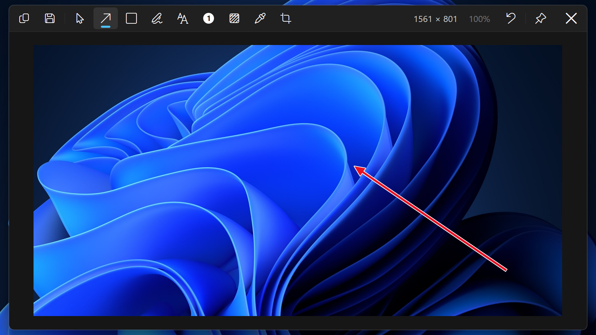
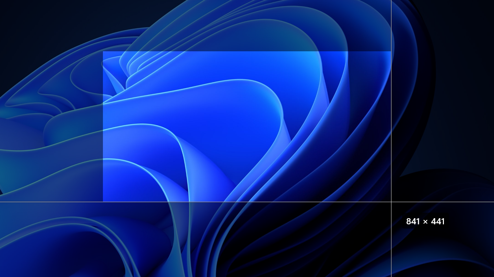
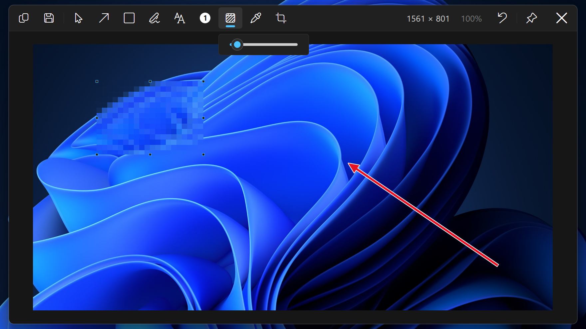

<p align="center">
  
</p>

<h1 align="center">Zilum</h1>

<p align="center">
  Screenshots for Windows 11. Capture, mark it up, copy.
</p>

<p align="center">
  <a href="https://github.com/dbeilin/Zilum/actions/workflows/ci.yml"></a>
  <a href="https://github.com/dbeilin/Zilum/releases/latest"></a>
  
  <a href="LICENSE"></a>
</p>

<p align="center">
  <a href="https://github.com/dbeilin/Zilum/releases/latest/download/Zilum.exe"><b>Download</b></a>
  &nbsp;·&nbsp;
  <a href="https://dbeilin.github.io/Zilum/">Website</a>
  &nbsp;·&nbsp;
  <a href="https://github.com/dbeilin/Zilum/releases">Changelog</a>
</p>

<p align="center">
  
</p>

## Features

- **Capture** a region, a window or the whole screen. PrintScreen freezes the screen; drag a region or click a window.
- **Mark it up** with arrows, rectangles, pen, text and numbered badges, then crop, resize or pick a colour off the image.
- **Blur** a region in one drag, and set how coarse it is.
- **Copy text** out of a region instead of the image, with the OCR built into Windows.
- **Pin** a capture above every other window to keep it in view.
- **Fast.** 50 ms from the key to the overlay on screen, against 198 ms for the Snipping Tool ([method and raw data](bench/)).
- **Small.** One 1.1 MB exe. No installer, no account, no network.

<table>
  <tr>
    <td width="50%"></td>
    <td width="50%"></td>
  </tr>
  <tr>
    <td align="center">Drag a region or click a window</td>
    <td align="center">Blur, with its level under the bar</td>
  </tr>
</table>

## Install

1. Download [`Zilum.exe`](https://github.com/dbeilin/Zilum/releases/latest/download/Zilum.exe) from the latest release and run it. Zilum lives in the tray.
2. The exe is not code-signed yet, so SmartScreen may stop it the first time: choose **More info**, then **Run anyway**. Each release lists the exe's SHA-256 next to it.
3. To have Zilum running after a restart, turn on **Start with Windows** in its Settings.

> [!NOTE]
> If PrintScreen still opens the Snipping Tool, turn off **Use the Print screen key to open screen capture** in Windows Settings › Accessibility › Keyboard.

## Usage

| Key | Does |
|---|---|
| <kbd>PrintScreen</kbd> | Capture: drag a region, or click a window |
| <kbd>Shift</kbd>+<kbd>PrintScreen</kbd> | Capture the whole screen |

Capture window and Copy text are in the tray menu, and either can have its own key in Settings. Every key can be changed there.

<details>
<summary>Keys in the editor</summary>

| Key | Does |
|---|---|
| <kbd>Enter</kbd> or <kbd>Ctrl</kbd>+<kbd>C</kbd> | Copy |
| <kbd>Ctrl</kbd>+<kbd>S</kbd> | Save to the save folder |
| <kbd>Ctrl</kbd>+<kbd>Shift</kbd>+<kbd>S</kbd> | Save as |
| <kbd>Ctrl</kbd>+<kbd>Z</kbd> / <kbd>Ctrl</kbd>+<kbd>Y</kbd> | Undo / Redo |
| <kbd>Ctrl</kbd>+<kbd>P</kbd> | Pin |
| <kbd>Esc</kbd> | Close |
| <kbd>S</kbd> <kbd>A</kbd> <kbd>R</kbd> <kbd>P</kbd> <kbd>T</kbd> <kbd>N</kbd> <kbd>B</kbd> <kbd>I</kbd> <kbd>C</kbd> | Select, Arrow, Rectangle, Pen, Text, Badge, Blur, Colour picker, Crop |

</details>

## Build

Zilum is one exe written in Rust. On Windows 11 with Rust 1.85 or later (MSVC toolchain):

```
cargo build --release
```

The exe is `target\release\Zilum.exe`.

## Licence

MIT, see [LICENSE](LICENSE).
